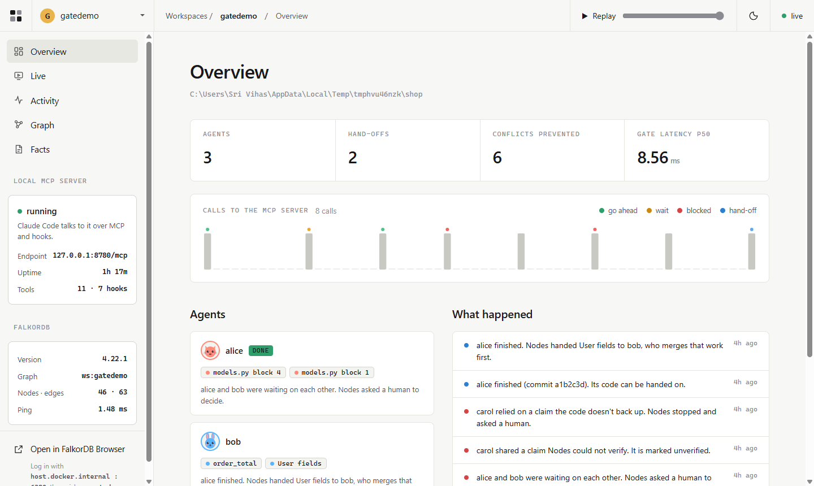
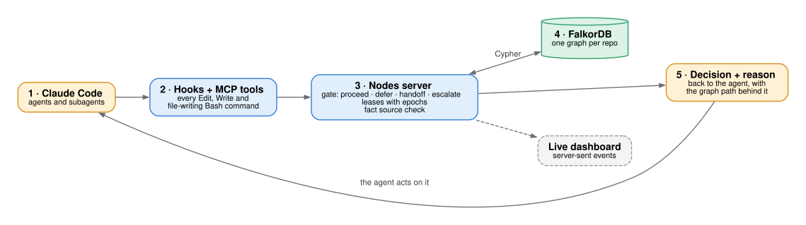
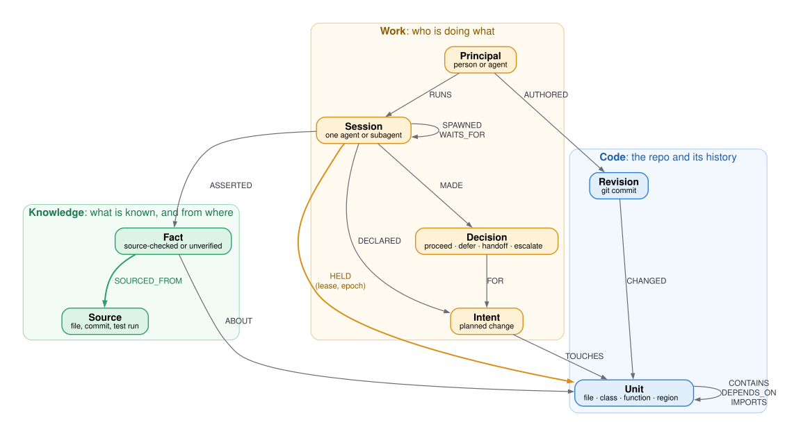

# Nodes

**Run your AI agents in parallel without them breaking each other's work.**

[](LICENSE)
[](https://github.com/scorp2006/Nodes/actions/workflows/ci.yml)
[](https://www.falkordb.com/)
[](https://modelcontextprotocol.io/)

[Demo video](DEMO_VIDEO_URL) · [Blog post](https://dev.to/scorp2006/from-12-to-38-how-a-graph-turned-claude-subagents-into-a-team-1h3n) · [Setup](SETUP.md)



## The problem

Give several coding agents one repo and they collide: same function, stale assumptions, unmergeable work.
Anthropic saw it in its own agent swarms: *"The PRs often conflicted with one-another, at which point they were then abandoned"*
([Patterns and problems in emerging multiagent systems](https://www.anthropic.com/research/multiagent-systems)).
Across 107k agent pull requests on GitHub, **27.67%** hit merge conflicts ([AgenticFlict](https://arxiv.org/abs/2604.03551)).

## Results

> **Pre-registered, held-out, same model in every condition.**
>
> **HiddenBench**, 40 held-out tasks, Claude Haiku 5.5: groups decide correctly **38%** of the time with Nodes,
> vs 15% chat, 12% placebo, 12% board without source checks. Primary test vs placebo **p = 0.006**
> ([result](results/test1_primary.txt), [pre-registration](results/preregistration_test1.md)).
>
> **CooperBench**, 45 feature pairs, Claude Sonnet 5.5: two agents' work merges cleanly **35/45** with Nodes vs
> 22/45 with the same procedure over chat, Holm **p = 0.002**
> ([result](results/cb1b_primary.txt), [pre-registration](results/preregistration_cb1b.md)).

**Every proof in one place:** [results/README.md](results/README.md): pre-registrations, outputs and recomputes for each number.

<details><summary>Scope and what didn't move</summary>

- Both features passing their tests: 23/45 vs 16/45, p = 0.092, not significant ([cb1b_primary.txt](results/cb1b_primary.txt)).
- One run per CooperBench pair, light Python repos (click, jinja, dirty-equals), low effort.
- On HiddenBench the source check is the active part: the same board without it scores 12%, like placebo.
- Nodes enforces ownership where our tests showed collisions happen (same function, shared import/module-level
  regions); multi-hop impact is surfaced to agents as advisory. A pre-registered test found multi-hop distance
  does not predict failures beyond "same function" ([detector2_report.md](results/detector2_report.md)).
</details>

## Quick start

Needs Docker, Python 3.11+ and Claude Code.

```bash
git clone https://github.com/scorp2006/Nodes.git && cd Nodes
python -m venv .venv && .venv/Scripts/python -m pip install -r requirements.txt   # macOS/Linux: .venv/bin/python
.venv/Scripts/python -m nodes up                                                   # FalkorDB + server + dashboard, leave running
.venv/Scripts/python -m nodes init --repo path/to/your/repo                       # once per repo
```

Open Claude Code in that repo and approve the `nodes` MCP server. That's it: every agent and subagent is
coordinated, and you watch it at **http://127.0.0.1:8780**. Plugin install, LAN mode and options: [SETUP.md](SETUP.md).

## How it works



Before an agent edits, a hook asks Nodes. Nodes checks the repo's graph and answers proceed, defer, handoff or
escalate, with the reason. The agent acts on that answer, and the dashboard shows it live.

## The graph data model



| node | what it means |
|---|---|
| `Unit` | a file, class, function or module-level region of code |
| `Session` | one running agent or subagent (`Principal` runs it) |
| `Intent` | a declared, planned change, and the units it `TOUCHES` |
| `Decision` | one gate verdict, with its reason and graph path |
| `Fact` / `Source` | a claim, and where it was checked (file lines, commit, test run) |
| `Revision` | a git commit, and the units it `CHANGED` |

Read from a live workspace with `db.labels()` and `db.relationshipTypes()`. Full schema: [docs/schema.md](docs/schema.md).

## How agents query the graph

| agent action | tool | what the graph answers | Cypher |
|---|---|---|---|
| about to edit | `before_acting` | is every target free, atomically? who holds it? | [lease](docs/cypher.md#the-gate-before_acting-nodesopspy) |
| planning | `declare_intent` | who else plans to change the same units? | [cypher.md](docs/cypher.md#other-tools) |
| sharing a finding | `post_fact` | does the quote match its source? | [post_fact](docs/cypher.md#posting-a-fact-post_fact-nodesopspy) |
| starting a task | `context_for` | which code, owners and facts matter for this task? | [cypher.md](docs/cypher.md#other-tools) |
| checking impact | `impact_of` | what is 1–3 calls or imports away, and who owns it? | [cypher.md](docs/cypher.md#other-tools) |
| finished | `coordinate` | release leases, wake whoever waits | [cypher.md](docs/cypher.md#other-tools) |

**Atomic lease claim** (all targets or none; writes are serialized):
```cypher
SET u.lease_owner = CASE WHEN ok THEN $me ELSE u.lease_owner END,
    u.lease_epoch = CASE WHEN ok AND (prev IS NULL OR prev <> $me) THEN coalesce(u.lease_epoch, 0) + 1 ELSE u.lease_epoch END
```
**Overlap check** (advisory):
```cypher
MATCH p = (u:Unit {uid: $id})-[:DEPENDS_ON|IMPORTS*1..3]-(v:Unit)
WHERE v.lease_owner <> $me AND v.lease_expires >= $now
RETURN v.uid, v.lease_owner, length(p) AS hops
```
**Deadlock check**:
```cypher
MATCH p = (:Session {uid: $owner})-[:WAITS_FOR*1..10]->(:Session {uid: $me})
RETURN [n IN nodes(p) | n.name] LIMIT 1
```

## Where the graph does the work

- **Who owns this unit right now?** One atomic query, so two agents never both get it.
- **Is this fact backed by a source?** An action that relies on an unchecked fact is escalated.
- **Is there a wait-for cycle?** A path back to yourself is a deadlock, sent to a human.
- **What does this change touch?** Call and import paths to code someone else is working on.

A real path from a recorded run ([gate_decision_paths.txt](results/v1/gate_decision_paths.txt)):

```
bob -NEEDS-> models.py#User.__body__ -LEASED_BY-> alice       → defer
alice -WAITS_FOR-> bob -WAITS_FOR-> alice                     → escalate
alice -DONE_AT-> a1b2c3d -HANDS-> models.py#User.__body__ -TO-> bob  → handoff
```

## The product is the research

- **Same behaviour:** every recorded tool call from both studies, replayed into the product: **4,916/4,916**
  identical replies, **0** leaks ([replay_equivalence.txt](results/repro/replay_equivalence.txt)). CI re-runs it on every push.
- **Scale:** 10, 50 and 100 agents claiming from a contested pool of 300 functions: **0** double-claims
  ([scale_test_nodes.txt](results/verify/scale_test_nodes.txt)).
- **Speed:** the conflict query on the CPython standard library (15,713 nodes) takes **2–4 ms** p50 at depths 1–4
  ([scale_test.txt](results/verify/scale_test.txt)).

## Reproduce

```bash
.venv/Scripts/python -m nodes up
.venv/Scripts/python verify/replay_equivalence.py     # needs the harness FalkorDB on :6379 (docs/reproduce.md)
.venv/Scripts/python verify/recompute_hiddenbench.py
.venv/Scripts/python demo/gate_demo.py                # all four verdicts, watch at :8780/?ws=gatedemo
```

Every result, its pre-registration and its script: [docs/reproduce.md](docs/reproduce.md). All proofs, including the
results that came out negative: [results/README.md](results/README.md).

## Tracks

- **Track 1 (main): agents on a shared graph.** FalkorDB is the coordination layer itself: leases, waits,
  facts and decisions are graph writes and reads.
- **Track 2:** a code knowledge graph built from 14 languages and git history, queried live by agents.
- **Track 3:** a live dashboard and replay of every agent decision, with the Cypher behind it.

## AI use

- Built with Claude Code (Claude Opus) as the coding agent, under the author's direction.
- The author designed the coordination model, chose and pre-registered every experiment, set the hypotheses and
  thresholds, and checked each result against its raw output.
- The agents inside the experiments are Claude Haiku 5.5 (HiddenBench) and Claude Sonnet 5.5 (CooperBench).
- Every number here comes from a committed script and its output.

## Credits

- [HiddenBench](https://arxiv.org/abs/2505.11556) (MIT) and [CooperBench](https://arxiv.org/abs/2601.13295) (MIT), used unmodified.
- [MAST: Why Do Multi-Agent LLM Systems Fail?](https://arxiv.org/abs/2503.13657)
- [AgenticFlict](https://arxiv.org/abs/2604.03551) · [Anthropic, Patterns and problems in emerging multiagent systems](https://www.anthropic.com/research/multiagent-systems)
- [Claude Code docs](https://docs.claude.com/en/docs/claude-code/overview) · [FalkorDB](https://www.falkordb.com/)

MIT licensed. See [LICENSE](LICENSE).
